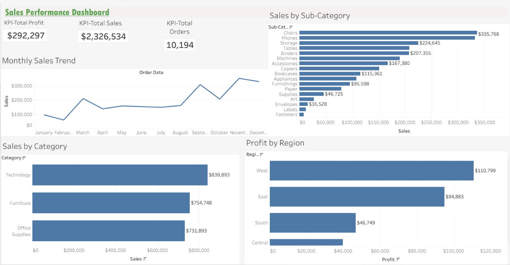

# Sales Performance Dashboard — Tableau

## Project Overview
This project presents an interactive sales performance dashboard built using Tableau and the Sample Superstore dataset. It explores sales trends, product category performance, sub-category sales, and regional profitability.

## Tools Used
- Tableau
- Sample Superstore dataset

## Dashboard Features
- **Total Sales:** Displays overall sales.
- **Total Profit:** Displays overall profit.
- **Total Orders:** Displays the order count.
- **Monthly Sales Trend:** Tracks sales across months.
- **Sales by Category:** Compares sales across product categories.
- **Sales by Sub-Category:** Identifies the strongest-selling sub-categories.
- **Profit by Region:** Compares profitability across regions.

## Key Business Insights
1. Technology recorded the highest sales among the product categories.
2. The West region recorded the highest profit among the regions.
3. November recorded the highest monthly sales in the chart.
4. Chairs recorded the highest sales among the sub-categories in the chart.

## Objective
To practice data visualization and exploratory business analysis by turning sales data into clear visual insights that can support business decision-making.

## Project File
The Tableau packaged workbook (`.twbx`) is included in this repository.
## Dashboard Preview

